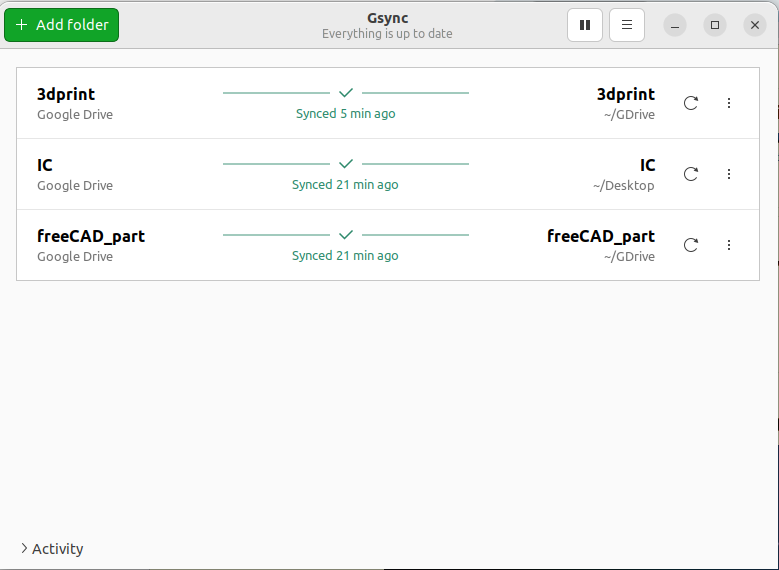
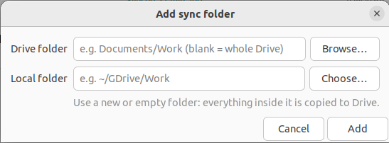

# Gsync

A small desktop app for two-way Google Drive sync, built on [`rclone bisync`](https://rclone.org/bisync/).
Pick a Drive folder and a local folder, and Gsync keeps them in step on a timer. It runs on Linux (GTK 3) and macOS (the same GTK 3 app through Homebrew, with a menu-bar item).

Both platforms install from source. There are no packaged releases.

## Why use Gsync

Gsync doesn't have its own sync engine. It runs `rclone bisync`, so what it adds is the interface, the scheduling and the safety checks around that command.

**Compared with `rsync`:** `rsync` can't talk to Google Drive, and it copies one way only. Keeping a Drive folder and a local folder in step means a real two-way tool, and that's what `rclone bisync` is. Gsync makes it usable without writing the commands yourself.

**Compared with running `rclone bisync` by hand or from cron:**

- Pairs are set up with a Drive folder picker, so you don't type remote paths or edit cron entries.
- Each pair runs on a timer, with pause, per-pair status, last-sync time and an activity log.
- Two-way changes are handled for you: when both sides changed, the newer file wins and the older copy is kept with a number suffix instead of being deleted.
- Dangerous setups are refused. Your home folder, its parents, hidden folders and system folders can't be chosen as a sync folder. That check exists because an early version once uploaded a home folder into Drive.
- The first sync of a pair is previewed before anything is copied.
- It starts at login, and on macOS it puts an item in the menu bar and sends notifications.

**What it is not:**

- It isn't a Google product, and it doesn't stream files on demand like Google Drive for desktop. Everything you sync is stored locally.
- Native Google Docs, Sheets and Slides are skipped (`--drive-skip-gdocs`). Only regular files sync.
- Linux syncs on a timer (default every 10 minutes). Only the macOS build also syncs soon after a local file changes.
- It is as reliable as `rclone bisync`. Check rclone's own documentation for the current limits of that command.
- [Insync](https://www.insynchq.com) is a paid app that does similar things. Gsync is a smaller, free alternative that you run from source, and it has had far less testing.

## Screenshots



The main window lists each pair as Drive folder, status and local folder. Pause, sync now and per-pair options are on the right.



**Add folder** asks for a Drive folder (blank means the whole Drive) and a local folder. Use a new or empty local folder, since everything inside it is copied to Drive.

## Requirements

| | Linux | macOS |
|---|---|---|
| OS | A desktop with GTK 3 (tested on Ubuntu) | macOS 12 or newer |
| Python | System `/usr/bin/python3` with GTK bindings | Homebrew's `python3` (not `/usr/bin/python3`) |
| rclone | 1.66.0 or newer | 1.66.0 or newer (Homebrew's is recent enough) |
| Other | | [Homebrew](https://brew.sh) and Apple's command line tools (`xcode-select --install`) |

Don't use Anaconda or conda Python on either platform. It has no GTK bindings.

## Install on Linux

```bash
sudo apt install python3-gi gir1.2-gtk-3.0 gir1.2-ayatanaappindicator3-0.1   # the last package (tray icon) is optional
curl https://rclone.org/install.sh | sudo bash
rclone version                                                                  # must show v1.66.0 or newer

git clone https://github.com/kahonn1002/Gsync.git
cd Gsync
./install.sh                                                                    # adds "Gsync" to the app menu
```

Ubuntu's `apt` rclone is usually too old, so use the rclone installer above. On other distributions, install the equivalent GTK 3 and PyGObject packages. I've only tested Ubuntu.

To run it without installing a menu entry: `/usr/bin/python3 gsync.py`

## Install on macOS

```bash
git clone https://github.com/kahonn1002/Gsync.git
cd Gsync
./install_mac.sh
```

The script installs any missing Homebrew packages (`rclone gtk+3 pygobject3 adwaita-icon-theme`), then builds `~/Applications/Gsync.app`. Open Gsync from Spotlight or Launchpad.

- If you move the repo folder, run `./install_mac.sh` again.
- To see the app's output in Terminal, run `/opt/homebrew/bin/python3 gsync.py`. On an Intel Mac, Homebrew lives in `/usr/local`, so use `/usr/local/bin/python3` there.
- macOS asks for permission the first time Gsync touches Desktop, Documents, Downloads or an external drive, and once for notifications. Allow both.

More detail and a test checklist: [`MACOS_TESTING.md`](MACOS_TESTING.md).

## Connect Google Drive

1. Open Gsync and click **Connect Google account**.
2. Paste your own Google API client ID and secret ([how to make one](https://rclone.org/drive/#making-your-own-client-id)). Leaving them blank uses rclone's shared client, which Google throttles heavily and which is being retired during 2026. Gsync shows a warning banner until you switch.
3. Sign in to Google in the browser window that opens.

rclone's config is stored per machine (`~/.config/rclone/rclone.conf`), so each computer signs in on its own. Don't copy it, or Gsync's `config.json`, between machines.

## Your first sync

The first sync of a pair runs `rclone bisync --resync`. It copies anything missing on either side, and when a file differs, Drive's copy wins. Do the first run with a throwaway Drive folder and an empty new local folder, and read the preview before you confirm. Gsync refuses your home folder, hidden folders and system folders as sync targets.

The full checklists are in [`TESTING.md`](TESTING.md) (Linux) and [`MACOS_TESTING.md`](MACOS_TESTING.md) (macOS).

## Files

| File | Purpose |
|---|---|
| `gsync.py` | The app |
| `install.sh` | Linux: adds the app-menu entry |
| `install_mac.sh` | macOS: installs packages and builds `Gsync.app` |
| `platform_mac.py`, `mac_*.py`, `mac_launcher.c` | macOS-only code, used only when running on macOS |
